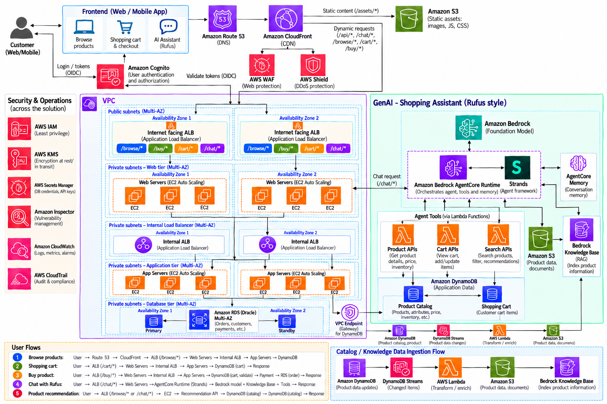
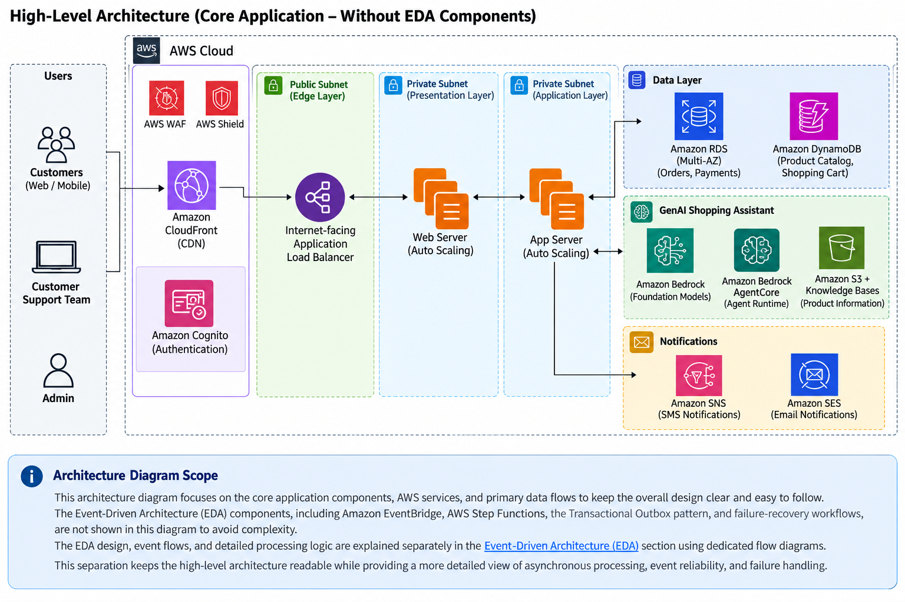
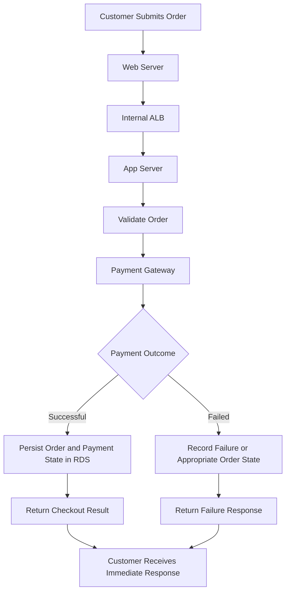
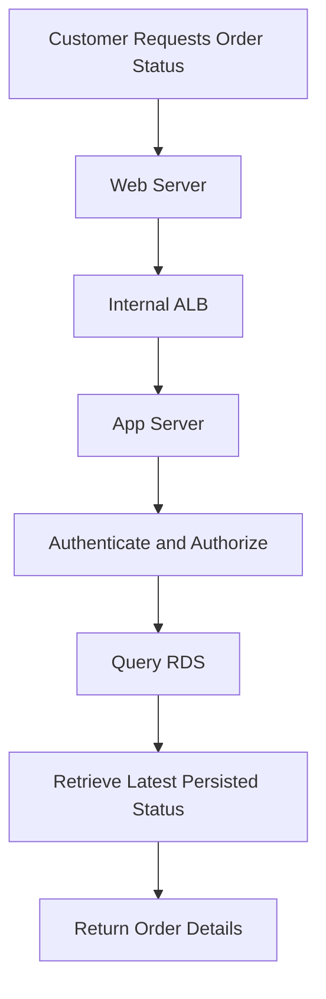
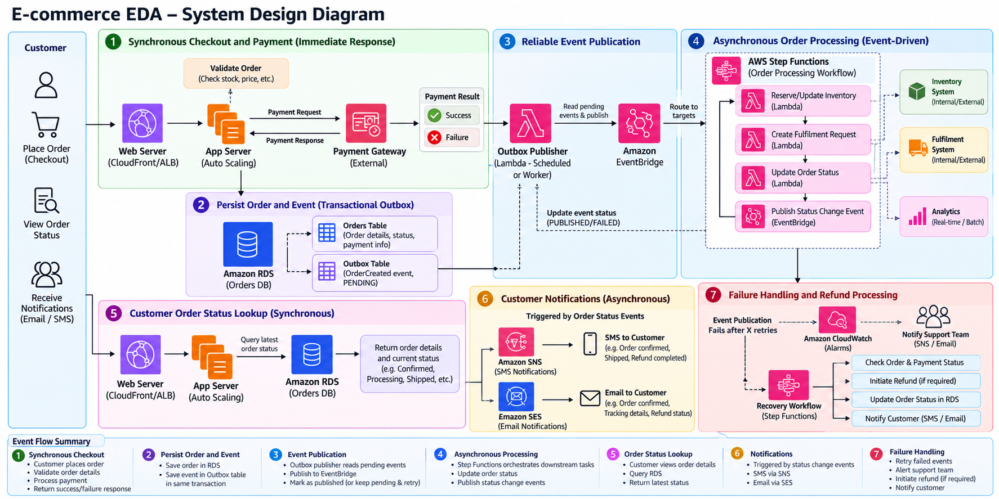
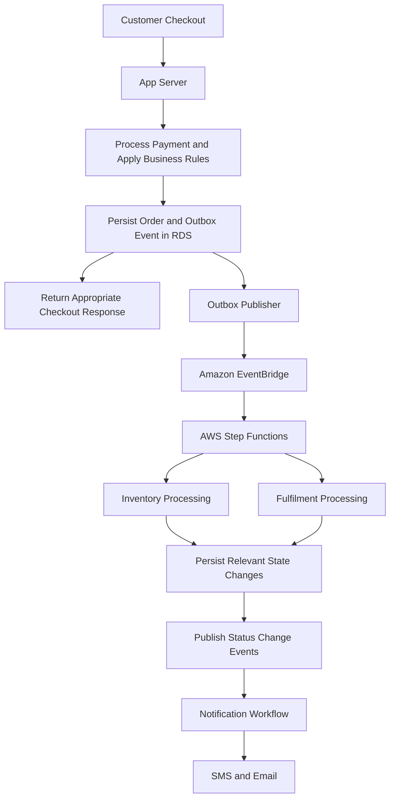
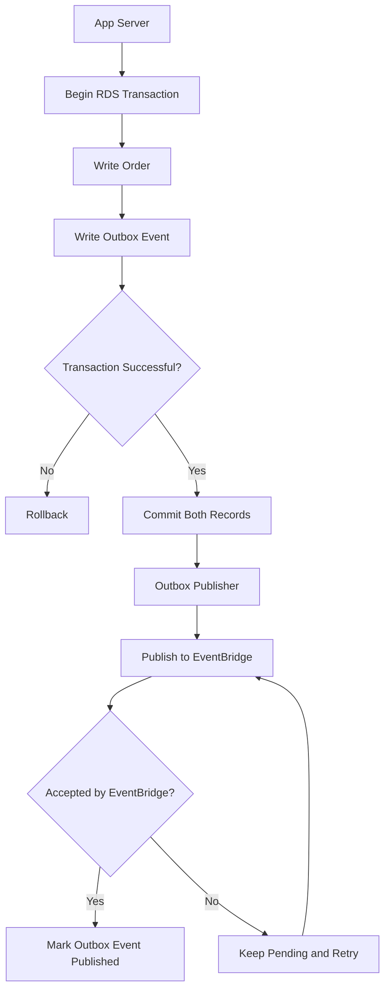
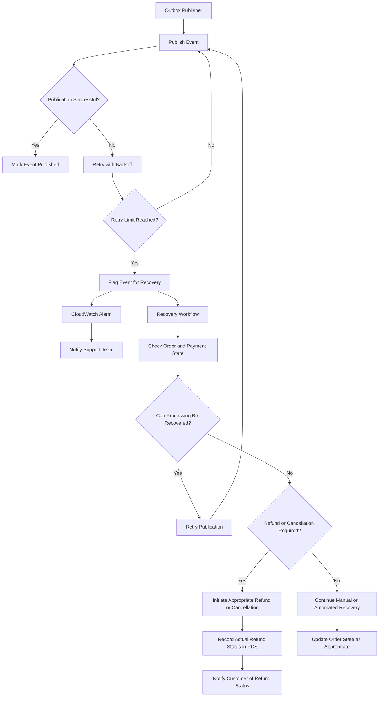
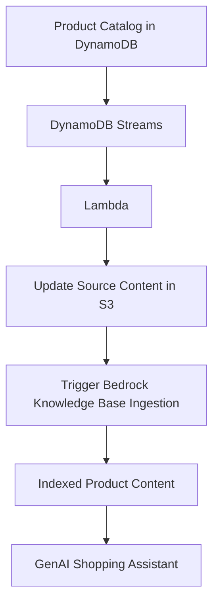

# Designing a Highly Available, Scalable, Secure E-Commerce Platform on AWS with a GenAI Shopping Assistant

## Table of Contents

1. [Overview](#1-overview)
2. [Business Requirements](#2-business-requirements)
3. [Functional and Non-Functional Requirements](#3-functional-and-non-functional-requirements)
4. [Architecture Diagram](#4-architecture-diagram)
5. [Functional Design](#5-functional-design)
6. [Non-Functional Design](#6-non-functional-design)
7. [Event-Driven Architecture (EDA)](#7-event-driven-architecture-eda)
8. [Summary](#8-summary)

---

## 1. Overview

This project presents the design of a scalable, secure, and highly available e-commerce platform using AWS services.

The architecture supports product discovery, shopping cart management, checkout, payment processing, order tracking, and a GenAI-powered shopping assistant.

The solution combines synchronous request-response processing with asynchronous, event-driven workflows to provide responsive customer interactions while decoupling downstream business operations.

### Key Architecture Highlights

- **High availability:** Deploy application components across multiple Availability Zones.
- **Scalability:** Use load balancing and Auto Scaling to accommodate changing traffic.
- **Data management:** Use Amazon RDS for transactional order data and Amazon DynamoDB for product catalog and shopping cart data.
- **Event-driven processing:** Use Amazon EventBridge to route business events and AWS Step Functions to orchestrate multi-step workflows.
- **Reliable event publication:** Use the Transactional Outbox pattern to address failures between database commits and event publication.
- **Security:** Use Amazon Cognito for user authentication, IAM for AWS access control, and encryption to protect sensitive data.
- **GenAI integration:** Use Amazon Bedrock and Amazon Bedrock AgentCore to support an AI-powered shopping assistant.

The design emphasizes reliability, security, operational visibility, and cost efficiency.


## 2. Business Requirements

### Business Problem

An e-commerce platform must handle varying customer traffic while maintaining a responsive shopping experience and reliably processing orders and payments.

Tightly coupled processing can cause delays when downstream services are slow or unavailable. Additionally, failures between database updates and event publication can prevent critical business operations from executing.

The proposed architecture addresses these challenges through scalable infrastructure, appropriate data stores, synchronous customer-facing operations, and asynchronous event-driven processing.

### Business Objectives

1. Provide a responsive shopping experience.
2. Support product discovery, cart management, checkout, and order tracking.
3. Provide immediate feedback on payment and checkout outcomes.
4. Process downstream order operations independently of customer requests.
5. Recover from transient failures without silently losing business events.
6. Notify customers about important order and payment status changes.
7. Introduce a GenAI-powered assistant for product-related questions and recommendations.
8. Maintain security, availability, and cost efficiency as the platform grows.


## 3. Functional and Non-Functional Requirements

### 3.1 Functional Requirements

| ID | Requirement | Description |
|---|---|---|
| FR-01 | User authentication | Allow customers to sign in securely. |
| FR-02 | Product catalog | Browse products and retrieve current product details. |
| FR-03 | Product search | Search, filter, and sort products. |
| FR-04 | Shopping cart | Add, update, and remove products from the cart. |
| FR-05 | Checkout | Validate the order and initiate payment processing. |
| FR-06 | Payment processing | Return the appropriate payment outcome to the customer. |
| FR-07 | Order management | Persist orders and track their lifecycle. |
| FR-08 | Order lookup | Retrieve the latest persisted order status. |
| FR-09 | Order fulfilment | Coordinate downstream inventory and fulfilment operations. |
| FR-10 | Customer notifications | Notify customers about relevant order, payment, shipping, and refund status changes. |
| FR-11 | GenAI shopping assistant | Answer product-related questions and support contextual product discovery. |
| FR-12 | Failure recovery | Retry failed operations, alert support teams, and initiate recovery or refunds when appropriate. |


### 3.2 Non-Functional Requirements

| ID | Requirement | Design Consideration |
|---|---|---|
| NFR-01 | Availability | Deploy critical application components across multiple Availability Zones. |
| NFR-02 | Scalability | Use load balancing, Auto Scaling, and managed services where appropriate. |
| NFR-03 | Performance | Keep customer-facing operations responsive and move suitable downstream tasks to asynchronous processing. |
| NFR-04 | Reliability | Implement retries, failure handling, idempotent consumers, and reliable event publication. |
| NFR-05 | Security | Apply least-privilege IAM, authentication, authorization, and encryption. |
| NFR-06 | Data integrity | Use database transactions and enforce business rules for orders and payments. |
| NFR-07 | Observability | Use Amazon CloudWatch for logs, metrics, alarms, and operational monitoring. |
| NFR-08 | Cost efficiency | Use managed and serverless services where appropriate and right-size compute resources. |
| NFR-09 | Maintainability | Separate application responsibilities and downstream business workflows. |

These requirements guide the architectural choices described in the following sections.


## 4. Architecture Diagram

The architecture separates the customer-facing application, transactional data stores, and downstream event-driven workflows.




### 4.1 High-Level Architecture




### 4.2 Major Architecture Components

| Component | Responsibility |
|---|---|
| Amazon CloudFront | Distribute web content with low latency. |
| AWS WAF and AWS Shield | Help protect the application against web exploits and distributed denial-of-service attacks. |
| Amazon Cognito | Manage customer authentication. |
| Internet-facing Application Load Balancer | Distribute incoming application traffic. |
| Web Server | Serve the web application and communicate with application services. |
| Internal Application Load Balancer | Route internal application requests to application servers. |
| App Server | Implement business logic, checkout, order management, and integrations. |
| Amazon RDS Multi-AZ | Persist transactional data such as orders and payment references. |
| Amazon DynamoDB | Store product catalog and shopping cart data. |
| Amazon EventBridge | Route business events to subscribed targets. |
| AWS Step Functions | Orchestrate multi-step business workflows. |
| AWS Lambda | Execute individual processing, integration, and event-handling tasks. |
| Amazon SNS and Amazon SES | Support customer and operational notifications through suitable integrations. |
| Amazon Bedrock | Provide foundation model capabilities for the GenAI assistant. |
| Amazon Bedrock AgentCore | Provide runtime and related capabilities for deploying and operating the AI agent. |
| Amazon S3 and Bedrock Knowledge Bases | Store source documents and support retrieval-augmented generation for contextual product information. |

**Architecture note:** Amazon DynamoDB is a managed service accessed through AWS service endpoints; it is not deployed inside the application VPC. A gateway VPC endpoint can provide private connectivity from the VPC to DynamoDB.


## 5. Functional Design

This section explains how the architecture implements the primary customer and business workflows.

### 5.1 Product Catalog and Search

**Objective:** Allow customers to browse categories, search for products, and view product details.

#### Request flow

```text
Customer
   |
   v
Amazon Route 53
   |
   v
Amazon CloudFront + AWS WAF
   |
   +---- Static assets ----> Amazon S3
   |
   +---- Dynamic requests
                |
                v
       Internet-facing ALB
                |
                v
          Web Servers
                |
                v
           Internal ALB
                |
                v
         Application Servers
                |
                v
             DynamoDB
          (Product Catalog)
                |
                v
          Product Response
```

#### Explanation

**Step 1: Customer accesses the website**

Route 53 resolves the application domain. CloudFront delivers static assets such as JavaScript, CSS, and product images from its cache or S3 origin.

AWS WAF and AWS Shield provide additional protection at supported entry points.

**Step 2: Customer browses products**

The frontend sends a dynamic request, such as:

```http
GET /browse/products?category=laptops
```

The internet-facing ALB routes the request to the web tier.

The web server forwards the application request through the internal ALB to the application tier.

**Step 3: Retrieve product information**

The application queries DynamoDB for the relevant product records.

DynamoDB is suitable for structured catalog data when its partition keys, sort keys, and secondary indexes are designed around the required access patterns.

The application accesses DynamoDB through a gateway VPC endpoint.

**Step 4: Return the response**

The application returns the matching product information to the frontend, which displays the product list.

#### Design considerations

- CloudFront reduces latency and origin requests for cacheable assets.
- DynamoDB supports scalable key-based lookups.
- Frequently accessed product records can be cached if freshness requirements permit.
- If advanced full-text search, autocomplete, or relevance-based filtering is required, Amazon OpenSearch Service can be introduced as a dedicated search layer.

**Important:** DynamoDB is the authoritative product data store in this design. Search indexes and AI knowledge indexes may be derived from that data and can lag behind the latest product updates.


### 5.2 Shopping Cart

**Objective:** Allow customers to manage cart items across requests and application-server instances.

#### Request flow

```text
Customer
   |
   v
Frontend
   |
   v
Internet-facing ALB
   |
   v
Web Servers
   |
   v
Internal ALB
   |
   v
Application Servers
   |
   v
DynamoDB
   |
   v
Updated Cart Response
```

#### Explanation

**Step 1: Add a product**

The customer adds a product to the cart. The frontend sends a request such as:

```http
POST /cart/items
```

The web tier forwards the request to the application tier.

**Step 2: Validate the request**

The application authenticates the customer and verifies that the product and requested quantity are valid.

**Step 3: Persist the cart**

The application writes the cart item to DynamoDB.

A possible data model is:

| Attribute | Example |
|---|---|
| Customer ID | `USER#1001` |
| Cart ID | `CART#1001` |
| Product ID | `PRODUCT#P101` |
| Quantity | `2` |
| Updated At | Timestamp |

The exact key design depends on the expected access patterns, including guest carts, multiple carts, and customer account requirements.

**Step 4: Return the updated cart**

The application returns the updated cart to the frontend.

The customer can subsequently change quantities, remove items, or continue shopping.

#### Why DynamoDB?

Cart operations commonly involve frequent, key-based reads and writes. DynamoDB can provide a scalable persistent store for these operations.

Because cart data is stored externally, application servers do not need to maintain cart state in local memory. Any healthy application instance can process the next request.

Amazon ElastiCache can be added if caching provides a measurable performance benefit, but it is not mandatory.


### 5.3 Checkout and Payment Processing — Synchronous

Checkout and payment operations provide immediate feedback to the customer.

#### Processing Flow

1. The customer submits an order.
2. The App Server validates the request and order details.
3. The application integrates with the payment gateway.
4. The application records the order and payment state in RDS.
5. The application returns the appropriate response to the customer.



The exact ordering of payment authorization, order persistence, and confirmation depends on the payment provider and business rules.

**Important design considerations:**

- Do not confirm an order before its required business conditions are met.
- A payment timeout may leave the payment outcome uncertain; reconcile with the payment provider before attempting another charge.
- Use idempotency controls to avoid duplicate charges or duplicate order creation.
- Store payment provider references or tokens rather than raw payment card details.

The checkout response should not wait for email or SMS delivery.


### 5.4 Order Management and Status Lookup — Synchronous

Customers can retrieve the latest persisted order details through an order-status API.



The App Server verifies that the customer is authorized to view the requested order before returning the data.

Possible order statuses include:

- `PENDING_PAYMENT`
- `CONFIRMED`
- `PROCESSING`
- `SHIPPED`
- `DELIVERED`
- `CANCELLED`
- `REFUND_PENDING`
- `REFUNDED`

The actual state transitions depend on the business workflow. The status API reflects the latest state recorded in RDS.

#### Why RDS?

Orders often involve related entities, relational queries, constraints, and transactional updates.

RDS is a suitable choice for these requirements.

DynamoDB remains the product catalog and cart store, while RDS stores the transactional order records.

The actual payment processing is performed by the payment provider; RDS stores appropriate payment-related metadata and transaction references.


### 5.5 GenAI Shopping Assistant

**Objective:** Answer natural-language product questions and help customers discover relevant products.

Example questions:
- Which laptop is suitable for software development?
- Does this phone support wireless charging?
- Compare these two products.
- Which hiking shoes are suitable for long treks?

#### Request flow

```text
Customer
   |
   v
Frontend Chat Interface
   |
   v
Web Server (EC2)
   |
   v
Amazon Bedrock AgentCore Runtime
   |
   +----> Strands Agent Framework
   |
   +----> Foundation Model
   |       Amazon Bedrock
   |
   +----> Product API
   |       Current product details
   |
   +----> Search API
   |       Product discovery
   |
   +----> Bedrock Knowledge Base
   |       Manuals and product documents
   |
   +----> AgentCore Memory
           Conversation context
   |
   v
Grounded Response
   |
   v
Customer
```

#### Explanation

**Step 1: Customer asks a question**

The customer enters a question in the chat interface.

For example:

"Recommend a laptop under ₹80,000 for software development."

The request reaches the web server, which invokes AgentCore Runtime through the configured application integration.

**Step 2: AgentCore Runtime executes the agent**

AgentCore Runtime hosts the agent execution environment.

The Strands Agents framework can be used to implement the agent logic, including tool selection and orchestration.

**Step 3: The agent interacts with the foundation model**

The agent interacts with a foundation model through Amazon Bedrock.

The model interprets the request and helps determine which information or tools are required to answer it.

**Step 4: Retrieve the required information**

The agent can invoke approved tools:

- **Product API:** Retrieves current product details, prices, and availability.
- **Search API:** Finds products matching the customer's search criteria.
- **Bedrock Knowledge Base:** Retrieves relevant passages from product descriptions, manuals, and documentation.
- **AgentCore Memory:** Provides relevant conversational context according to the configured memory strategy.

These components have different responsibilities.

The Product API is the preferred source for live prices and availability. The Knowledge Base is used for semantic retrieval over indexed product content.

**Step 5: Generate a response**

The agent combines the relevant retrieved information with the model's response generation.

It returns a product-focused answer to the frontend.

For example, the response could identify laptops matching the customer's budget and explain which specifications make them suitable for programming.

#### Product knowledge ingestion

Product information and supporting documents can be prepared for retrieval through a separate ingestion workflow.

```text
DynamoDB
(Product Catalog)
     |
     v
DynamoDB Streams
     |
     v
AWS Lambda
(Transform / Enrich)
     |
     v
Amazon S3
     |
     v
Bedrock Knowledge Base
(Index Product Content)
```

Product manuals and other documents can also be stored in S3 and ingested into the Knowledge Base.

DynamoDB Streams capture product-table changes, and Lambda can transform selected changes into documents suitable for ingestion.

The ingestion mechanism must account for duplicate events, retries, and failed processing.

The Knowledge Base does not automatically become a real-time DynamoDB query interface. Its indexed content may lag behind the current product records, so live information should be retrieved through application APIs.

#### Security considerations for the agent

- Allow only approved tools and operations.
- Enforce authorization inside the APIs that access customer and order data.
- Treat retrieved documents as untrusted input.
- Protect sensitive information in prompts, memory, and logs.
- Prevent the agent from executing arbitrary database queries or accessing unauthorized customer records.

The model should not be treated as a security boundary. Application and data-layer authorization must enforce the actual permissions.


### 5.6 Product Recommendations

This should explain whether recommendations are:
- Rule-based: Recommend products based on category, price, or attributes.
- Personalized: Recommend products based on customer preferences and purchase history.
- AI-powered: Use Amazon Bedrock to recommend relevant products based on the customer's natural-language request.
For your current architecture, I recommend starting with AI-powered product recommendations using the GenAI assistant, Product API, and Search API. The agent can interpret the customer's preferences, retrieve matching products, and explain why each product is relevant.

If you want personalized recommendations based on customer behaviour and purchase history, you could consider Amazon Personalize as a future enhancement rather than adding unnecessary complexity to the initial design.


### 5.7 Customer Notifications

Notifications are triggered by relevant business events and persisted state changes.

| Trigger | Customer communication |
|---|---|
| Checkout accepted | Order confirmation |
| Payment failure | Payment failure information |
| Order shipped | Shipping notification |
| Order delivered | Delivery confirmation |
| Order cancelled | Cancellation notification |
| Refund initiated | Refund processing update |
| Refund completed | Refund confirmation |
| Refund failure | Appropriate status update or support guidance |

Amazon SNS can support SMS notifications, while Amazon SES can send email.

Notifications are handled asynchronously so that delivery delays do not unnecessarily increase checkout latency. Messages should accurately reflect the current order or payment state.


## 6. Non-Functional Design

### 6.1 High Availability

- Deploy application servers across multiple Availability Zones.
- Use load balancers to distribute traffic across healthy targets.
- Configure RDS Multi-AZ for database availability.
- Select suitable availability and recovery configurations for other managed services.

Multi-AZ deployment improves resilience but does not eliminate every failure scenario. Recovery procedures and operational monitoring are also required.


### 6.2 Scalability and Performance

- Use Auto Scaling for application compute capacity.
- Use managed services that can scale with workload demand.
- Separate synchronous customer-facing requests from downstream processing.
- Introduce queues or other buffering mechanisms when consumers need to absorb bursts of work.
- Use caching where it improves performance without compromising data correctness.


### 6.3 Security

- Use Amazon Cognito for customer authentication.
- Apply least-privilege IAM policies to application components and service integrations.
- Keep application servers and databases in private subnets where appropriate.
- Use TLS for data in transit and encryption at rest.
- Protect public endpoints using AWS WAF and AWS Shield.
- Restrict access to order records and customer information.
- Store payment references securely and avoid storing raw card data.


### 6.4 Reliability and Fault Tolerance

- Implement bounded retries with backoff for transient failures.
- Make event consumers idempotent.
- Use the Transactional Outbox pattern to address the database/event dual-write problem.
- Configure alarms for failed workflows and events that remain pending too long.
- Implement operational recovery for events that repeatedly fail.
- Use explicit cancellation and compensation logic for multi-step business workflows.


### 6.5 Monitoring and Observability

Amazon CloudWatch can be used to monitor:

- Application errors and latency.
- Load balancer health and target failures.
- Database performance and availability.
- Failed Step Functions executions.
- Lambda errors and throttling.
- Outbox events awaiting publication.
- Failed notification and refund operations.

Operational alerts can be routed to the support team using Amazon SNS or an integrated incident-management system.


### 6.6 Cost Optimization

- Right-size application compute resources.
- Use Auto Scaling to match demand.
- Select suitable DynamoDB capacity and billing options.
- Monitor database utilization and storage growth.
- Set budgets and billing alerts.
- Apply lifecycle policies to retained data and logs where appropriate.
- Avoid introducing additional workflow and messaging services unless they provide a clear reliability or operational benefit.


## 7. Event-Driven Architecture (EDA)

### 7.1 Why EDA?

Not every business operation needs to complete before the customer receives an initial checkout response.

Inventory processing, fulfilment, analytics, and subsequent notifications can run asynchronously. Event-driven architecture allows these operations to be triggered by business events without tightly coupling the producer to every downstream consumer.

Amazon EventBridge routes events, while AWS Step Functions coordinates workflows that require multiple steps, decisions, retries, or compensation.


### 7.2 EDA System Design Diagram




### 7.3 Recommended EDA Use Cases

| Business event | Downstream processing |
|---|---|
| `OrderCreated` | Start order-processing workflow. |
| `InventoryReserved` | Continue fulfilment or update order state. |
| `OrderShipped` | Send shipping notification. |
| `OrderDelivered` | Send delivery notification. |
| `OrderCancelled` | Release inventory and initiate a refund when required. |
| `RefundCompleted` | Update order/payment state and notify the customer. |
| `ProductUpdated` | Refresh product-related knowledge-base content. |

Events should represent meaningful business state changes. Consumers should not assume that an event has completed every downstream task.


### 7.4 Order Processing: Synchronous and Asynchronous Paths

The initial checkout request remains synchronous for the operations that require immediate feedback.

After the order and its corresponding event record are persisted, downstream processing can proceed asynchronously.



This design separates the initial customer response from the remaining order lifecycle.

The event must be published reliably. A successful database commit followed by a failed event publication must not silently leave the order without its corresponding downstream trigger.


### 7.5 Reliable Event Publication — Transactional Outbox

A common distributed-systems problem occurs when a database write succeeds but publishing the corresponding event fails.

The Transactional Outbox pattern addresses this problem by writing the business record and event record in the same database transaction.



**Key considerations:**

- The order and event record are committed atomically.
- The publisher retries temporary publication failures.
- A successfully published event may be delivered or processed more than once.
- Consumers must be idempotent.
- Marking an event as published does not mean the downstream business workflow has completed.

The Outbox Publisher is an application component that must be implemented. It could use scheduled polling, a continuously running worker, or another suitable publishing mechanism.


### 7.6 Outbox Failure Handling, Refunds, and Notifications

If publication continues to fail after the configured retry limit, the event should remain recoverable and an operational alert should be raised.

The recovery workflow should verify the actual order and payment state before taking corrective action.



#### Failure-handling principles

1. **Retry first:** Attempt to recover transient failures before cancelling an order.
2. **Alert support:** Raise an alarm when events remain pending too long or exceed retry thresholds.
3. **Verify payment:** Confirm whether the payment was authorized, captured, or already refunded.
4. **Refund when appropriate:** Initiate a refund only when the business rules require it.
5. **Prevent duplicate refunds:** Use payment-provider idempotency controls and persist refund references.
6. **Track refund outcomes:** Distinguish between a refund request, a pending refund, a completed refund, and a failed refund.
7. **Notify accurately:** Send SMS or email notifications based on the recorded outcome.

Failure to publish an event does not automatically mean that a refund is required. The order may still be recoverable through retry or reconciliation.


### 7.7 Choosing the Right AWS Service

| Service | Primary responsibility |
|---|---|
| Amazon EventBridge | Route business events to appropriate targets. |
| AWS Step Functions | Orchestrate multi-step workflows, branching, retries, and recovery. |
| AWS Lambda | Execute individual processing and integration tasks. |
| Amazon SQS | Buffer work and isolate consumers when durable queues are needed. |
| Amazon SNS | Fan out notifications and support SMS use cases. |
| Amazon SES | Send email notifications. |
| Amazon CloudWatch | Monitor failures, pending events, and workflow health. |
| Amazon RDS | Persist orders, event records, and relevant business state. |

These services have complementary roles. EventBridge handles event routing, Step Functions manages workflow execution, and SQS provides queue-based buffering where appropriate.


### 7.8 Product Knowledge Base Ingestion

The architecture also includes an event-driven data-ingestion path for the GenAI shopping assistant.



This path keeps the knowledge base updated with product-related content.

**Important:** Knowledge-base ingestion and indexing are asynchronous and can introduce delays. For current prices, stock levels, and other operational data, the assistant should query the authoritative Product API instead of relying exclusively on retrieved documents.


### 7.9 EDA Summary

The proposed EDA design provides:

- Decoupled downstream processing.
- Reliable recording of events through the Outbox pattern.
- Retries and operational recovery for failed publication.
- Workflow orchestration for complex business processes.
- Customer and support notifications.
- Idempotent handling of duplicate events.
- Separation between the initial checkout response and the broader order lifecycle.


## 8. Summary

This architecture demonstrates how AWS services can be combined to build a secure, scalable, and resilient e-commerce platform.

The design uses synchronous processing for checkout, payment outcomes, and order-status lookups, while asynchronous workflows handle downstream order processing, fulfilment, and notifications.

The Transactional Outbox pattern addresses the risk of losing event publication after a successful database commit. Amazon EventBridge routes business events, AWS Step Functions coordinates multi-step workflows, and Amazon CloudWatch provides operational monitoring.

The architecture also integrates Amazon Bedrock and Amazon Bedrock AgentCore for contextual product assistance while preserving authoritative operational APIs for current product and cart data.

### Key Architectural Decisions

- Separate customer-facing requests from downstream processing.
- Keep order and event records consistent through an atomic database transaction.
- Use retries, idempotency, and recovery workflows to handle failures.
- Initiate refunds only when the verified order and payment state requires them.
- Notify customers based on persisted business outcomes.
- Apply security, observability, and cost optimization throughout the design.
